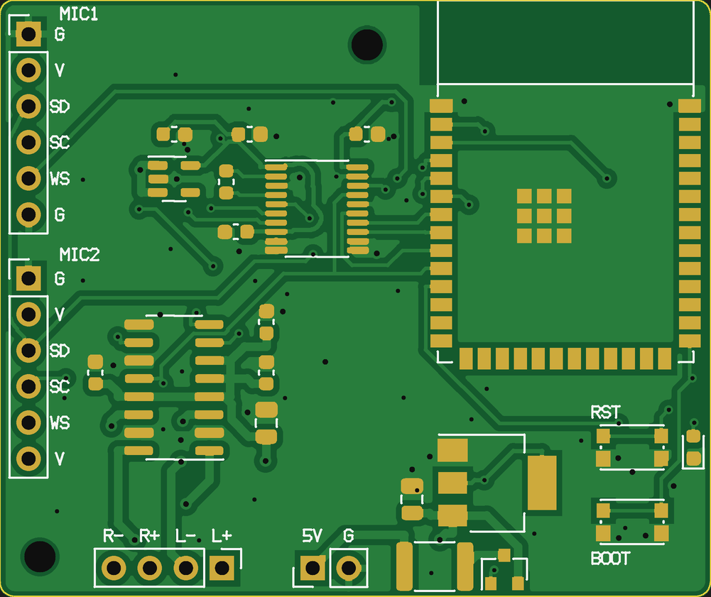
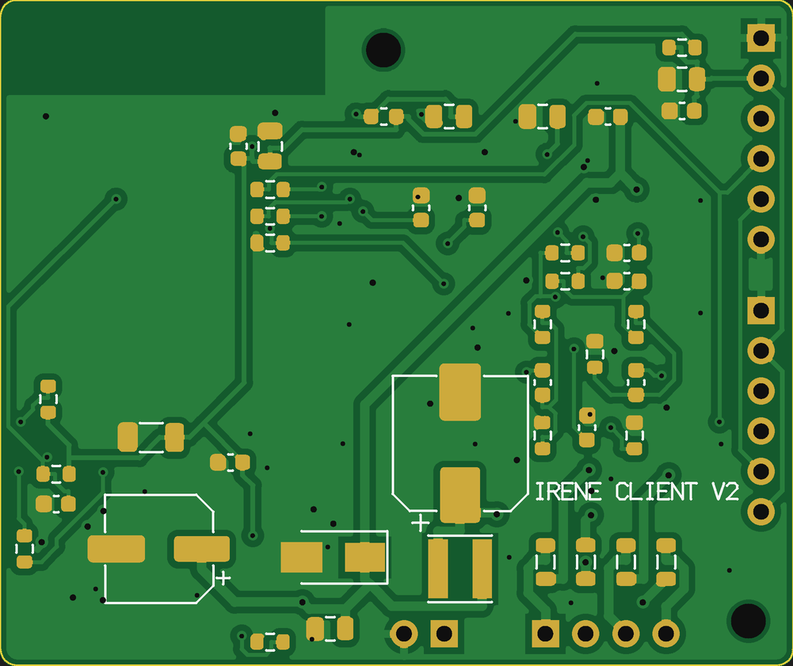
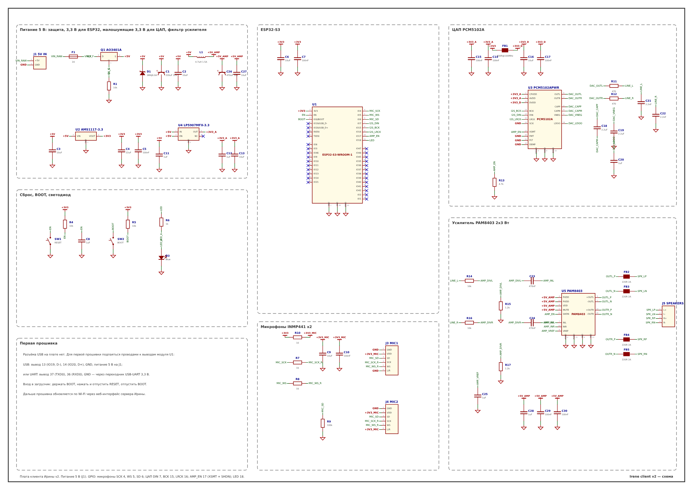

# Плата клиента Ирины v2

Весь клиент на одной двухсторонней плате **50×42 мм**: ESP32-S3, стереоЦАП PCM5102A, усилитель PAM8403 2×3 Вт,
разъёмы для двух микрофонов INMP441. Детали SMD стоят с обеих сторон (крупные — электролиты, дроссель, защитный диод —
снизу), штыри — в отверстия. Питание 5 В на штыри, все стабилизаторы и фильтры на плате. Разъёма USB нет: первая
прошивка — проводами к выводам модуля, дальше — по Wi-Fi.

| Сверху | Снизу |
|---|---|
|  |  |

Картинки сделаны из готовых Gerber-файлов (вид снизу — зеркальный, как если перевернуть плату).

## Файлы

| Файл | Что это |
|---|---|
| `kicad/` | **проект KiCad**: схема, плата с разводкой и заливками, правила (зазоры) |
| `irene-client-gerber.zip` | Gerber + сверловка, собранные генератором (для заказа без KiCad) |
| `schematic.pdf` | принципиальная схема (A3) |
| `img/assembly-top.png`, `img/assembly-bottom.png` | сборочный чертёж: где какая деталь, номиналы, первый вывод — красная точка |
| `bom.csv` | перечень элементов (Excel, разделитель «;») |
| `bom-jlcpcb.csv`, `cpl-jlcpcb.csv` | перечень и координаты деталей (обе стороны) в формате JLCPCB для заводского монтажа |

## Проект KiCad

Открыть `kicad/irene-client.kicad_pro` в KiCad 7, 8 или 9 (проект в формате KiCad 6, новая версия сама предложит его
обновить). Библиотеки ставить не нужно: символы и посадочные места лежат внутри файлов.

1. **Плата** (`irene-client.kicad_pcb`): нажать **B** — KiCad зальёт землю на обоих слоях (заливки заданы, но в файле не
   залиты). Затем «Проверка → Проверка правил проектирования (DRC)».
2. **Правила**: дорожки и переходы между собой — не ближе 0,3 мм (файл `irene-client.kicad_dru`), от дорожки до вывода
   микросхемы — 0,2 мм: у PCM5102A шаг выводов 0,65 мм, с бо́льшим зазором к ним не подвести дорожку. Ширина дорожек:
   сигналы 0,25 мм, питание 3,3 В — 0,3 мм, 5 В, земля и динамики — 0,6 мм.
3. **Gerber**: «Файл → Изготовление → Gerber» (слои F/B.Cu, F/B.Paste, F/B.Silkscreen, F/B.Mask, Edge.Cuts) и
   «Сверловка» — сжать в zip и загрузить на сайт фабрики.
4. Схема (`irene-client.kicad_sch`) связана с платой: «Обновить плату по схеме» (F8) не должна предлагать изменений,
   кроме служебных.

## Штыри на плате

| Разъём | Выводы (по шелкографии) | Что подключать |
|---|---|---|
| J1 | 5V, G | блок питания 5 В, 2 А (5V — квадратная площадка) |
| J5 | L+ L− R+ R− | динамики 4–8 Ом. Минусы динамиков с землёй **не соединять** (выходы мостовые) |
| J3 «MIC1» | G V SD SC WS G | микрофон 1 INMP441: GND, VDD, SD, SCK, WS, L/R (L/R уже на земле) |
| J4 «MIC2» | G V SD SC WS V | микрофон 2 INMP441: то же, L/R уже на 3,3 В (правый канал) |

Провода к микрофонам — до 20–30 см, лучше витой парой или в общей оплётке с землёй.

## Первая прошивка без USB-разъёма

Подпаяться тонкими проводами к выводам модуля U1 (нумерация — по сборочному чертежу, вывод 1 — красная точка):

- **через USB**: вывод 14 — D+ (зелёный провод USB), вывод 13 — D− (белый), земля — любой вывод G, питание — 5 В на J1.
  В Arduino IDE: плата «ESP32S3 Dev Module», **USB CDC On Boot: Enabled**, остальное — как в `esp32_client/README.md`;
- **или через переходник USB-UART на 3,3 В**: вывод 37 (TXD0) → RX переходника, вывод 36 (RXD0) → TX, GND → GND.

Вход в загрузчик: держать BOOT, нажать и отпустить RST, отпустить BOOT. После первой прошивки провода снять —
дальше обновления идут по воздуху («Прошивка клиентов» в веб-интерфейсе сервера).

## Схема вкратце



- **Вход 5 В**: самовосстанавливающийся предохранитель 2 А → защита от переполюсовки (P-MOSFET AO3401A) →
  TVS-диод 6 В → 220 мкФ.
- **3,3 В для ESP32 и микрофонов** — AMS1117-3.3; микрофоны дополнительно через RC-фильтр 10 Ом + 10 мкФ.
- **3,3 В для аналоговой части ЦАП** — отдельный малошумящий LP5907; цифровая часть ЦАП — через ферритовую бусину.
- **Усилитель** питается отдельной веткой: дроссель 4,7 мкГн + 470 мкФ прямо под микросхемой (снизу). Импульсный ток
  усилителя не идёт через цифровую часть — то, что раньше давал аккумулятор 18650.
- **Земля** — заливка на обоих слоях, сшитая переходными отверстиями. Под антенной модуля меди нет на обоих слоях.
- **ЦАП и усилитель включает прошивка** (GPIO 17 → XSMT ЦАП и SHDN усилителя): в тишине они выключены — нет шипения.
- Делитель 10к/1,2к на входе PAM8403: полной громкости соответствует почти полная мощность усилителя без перегрузки.

GPIO: микрофоны SCK 4, WS 5, SD 6; ЦАП DIN 7, BCK 15, LRCK 16; включение ЦАП и усилителя 17; светодиод 18;
кнопка BOOT — GPIO 0. Те же, что в прошивке (`esp32_client/IreneClient/config.h`, с версии 3.4).

## Заказ и сборка

- **Заказ**: 2 слоя, 1,6 мм, 50×42 мм; минимальная дорожка 0,25 мм, зазор 0,2 мм (у выводов ЦАП), отверстия от 0,3 мм.
  Покрытие HASL lead free или ENIG.
- **Заводской монтаж** (по желанию): загрузить `bom-jlcpcb.csv` и `cpl-jlcpcb.csv`, монтаж с двух сторон (в файле
  координат указана сторона, Top/Bottom). Поворот деталей в предпросмотре иногда приходится поправить вручную.
- **Ручная сборка**: сначала нижняя сторона (мелкие детали, затем дроссель, диод, электролиты), потом верхняя:
  микросхемы с мелким шагом (U3, U5), стабилизаторы, пассивные, кнопки, модуль ESP32, в конце штыри.
  До установки модуля подать 5 В на J1 через резистор 10–20 Ом и проверить 3,3 В на выходах AMS1117 и LP5907.

## Как пересобрать

Всё генерируется скриптами из `hardware/gen` (детали и цепи — `design.py`, расстановка — `placement.py`):

```
IRENE_PCB_EXT=<папка с kiutils, библиотеками KiCad и freerouting> python3 hardware/gen/build.py [--route]
```

Скрипт сам проверяет результат: связность всех цепей и отсутствие замыканий — по готовым Gerber; зазоры — по разводке;
цепи схемы KiCad — по сравнению с `design.py`.
